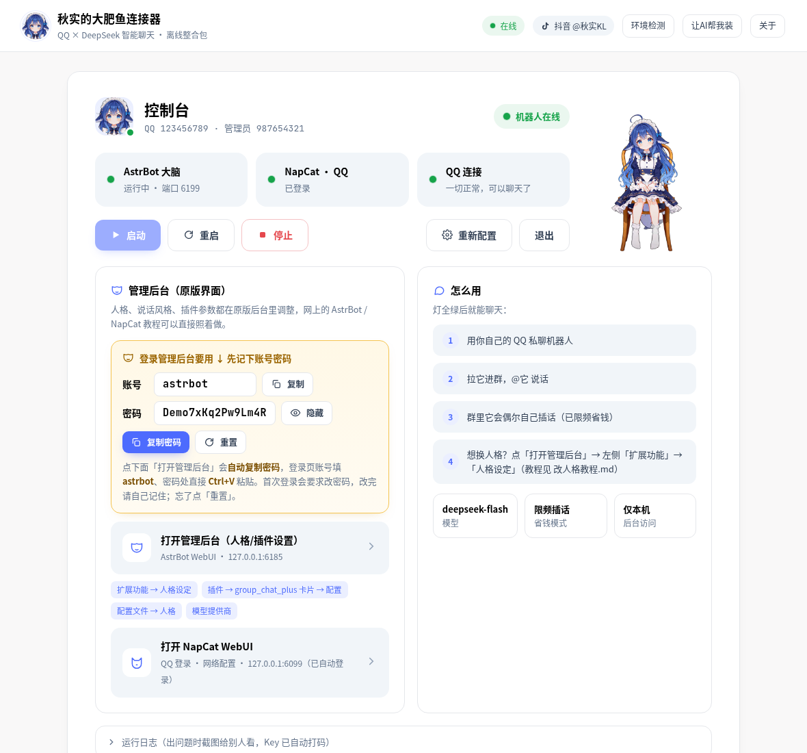

# 秋实的大肥鱼连接器

让 QQ 接上 DeepSeek 的 **Windows 离线整合包**。解压即用，不用装 Python，也不用自己下载组件。

- 作者：**秋实KL** · 抖音 **@秋实KL**
- 内置：AstrBot v4.29.3 · NapCat v4.18.41（Node 版）· astrbot_plugin_group_chat_plus · **表情包管理器 meme_manager v5.2.7** · 嵌入式 Python 3.12
- 默认表情包：首次启动**后台静默**安装「DeepSeek 二创表情包」（174 张；因上游 LICENSE=NOASSERTION 不随公开 zip 分发图片，无下载按钮/进度条）
- 默认人格「小鱼」已启用表情包工具；内置技能 documents/spreadsheets/pdf/skill-creator 默认关闭
- 默认模型：DeepSeek `deepseek-flash`
- **仅限免费分发，禁止任何形式的售卖或商用。** 如果你是花钱买到的，说明你被骗了。

## 准备
- Windows 10/11 64 位电脑
- 一个 **DeepSeek API Key**：到 https://platform.deepseek.com 注册 → 充值 → 在「API Keys」里创建，复制以 `sk-` 开头的那串
- 一个给机器人用的 **QQ 小号**（请先看下方的「防封提醒」）

## 三步上手
1. **解压**：把压缩包解压到**没有中文和空格的路径**，例如 `D:\dafeiyu`，然后双击带蓝色小鱼图标的 **`秋实的大肥鱼连接器.exe`**（第一次运行后整个文件夹也会显示小鱼图标，桌面会自动生成同款图标的快捷方式）。
2. **填信息**：粘贴 DeepSeek API Key，再填机器人 QQ 号（管理员 QQ 可以不填），点「保存并启动」。
3. **扫码**：用**机器人那个 QQ 号**的手机 QQ 扫描窗口里的二维码。状态全部变绿就成功了，可以用你自己的 QQ 私聊它，或者在群里 @它。

以后再用：双击启动 bat 即可，一般不需要重新扫码。

## 打不开或者报错？
- **环境检测**：双击 `环境检测.bat`，或在启动器顶部点「环境检测」。它会检查 WebView2、VC++ 运行库、端口占用、磁盘、杀毒软件拦截、DeepSeek 连通性等问题。缺 WebView2 或 VC++ 运行库的话点「修复」：会用 winget 在线安装（需联网）；没有 winget 时按提示打开微软下载页手动安装。
- **调试**：双击 `调试启动（出问题时用）.bat` 可以看到日志。

## 让 AI 帮我装
电脑上如果有 Cursor、Claude Code、Codex 这类本地 AI 助手：
1. 用它打开解压后的文件夹；
2. 把 `复制这句话给你的AI.txt` 里的那句话发给它（启动器顶部的「让AI帮我装」也能一键复制）。

AI 会按 `AGENTS.md` 依次做环境检测、修复、配置和启动。**API Key 请你自己粘贴**，不要发到任何聊天群里。

## 想让机器人更有人情味？
见 [推荐插件.md](docs/推荐插件.md)。**表情包管理器已预装**，首次启动后台静默安装 DeepSeek 二创表情包（无需手动下载）；其它如贴表情、戳一戳等见文档。

## 改人格 / 高级设置
在启动器「控制台」页点「打开管理后台」（AstrBot 原版界面）。

> 🔑 **登录账号密码看这里**：按钮上方有一张**黄色「账号 / 密码」卡片**。账号固定是 `astrbot`，密码是自动生成的随机密码（不是默认密码）。点「打开管理后台」时会**自动把密码复制到剪贴板**，并弹窗再显示一次——到登录页账号填 `astrbot`，密码框直接 **Ctrl+V** 粘贴即可。首次登录会要求改密码，改完请自己记住；忘了就点卡片里的「重置」。

- 改人格：左侧「扩展功能」→「人格设定」→「创建人格」，再到「配置文件」→「人格」→「默认采用的人格」选中它。详见 `改人格教程.md`。
- 插话频率：左侧「插件」→ group_chat_plus 卡片 →「配置」
- 换模型或 Key：左侧「模型提供商」

## 费用
- 本整合包**免费**。
- DeepSeek 按调用量收费，以官网价格为准。日常聊天一般**一个月几块钱**；群越活跃、人设越长，花得越多。
- 群聊插话已经默认限频来省钱。建议在 DeepSeek 后台设置余额提醒。

## ⚠️ 防封提醒
- QQ 机器人**不是腾讯官方功能**，有封号风险，后果请自行承担。**一定要用小号，别用主号。**
- 新号先正常养几天，再开机器人；不要刚登录就拉进大群刷屏。
- 不要发广告、色情、政治、违规内容；不要让它冒充真人去骗人。
- 尽量固定在同一台电脑、同一网络环境下登录；频繁异地登录容易触发风控。
- 被风控时会提示「冻结」或要求验证：先停用几天，手动登录 QQ 完成验证后再试。

## 安全
- 所有服务只监听本机 `127.0.0.1`，不对外开放端口。
- API Key 只保存在本机配置里，界面上和日志里都会打码。
- 分享整合包之前，**删掉 `settings.json`、`runtime\AstrBot\data` 和 `logs` 文件夹**，避免泄露 Key 和 QQ 登录信息。

## 许可
各组件许可见 `licenses/` 与 `licenses/README-许可与致谢.md`。AstrBot 和 group_chat_plus 使用 AGPL-3.0，NapCat 使用其《有限再分发许可》（禁止商用），缺运行库时通过 winget / 微软官网安装，不随包分发。
